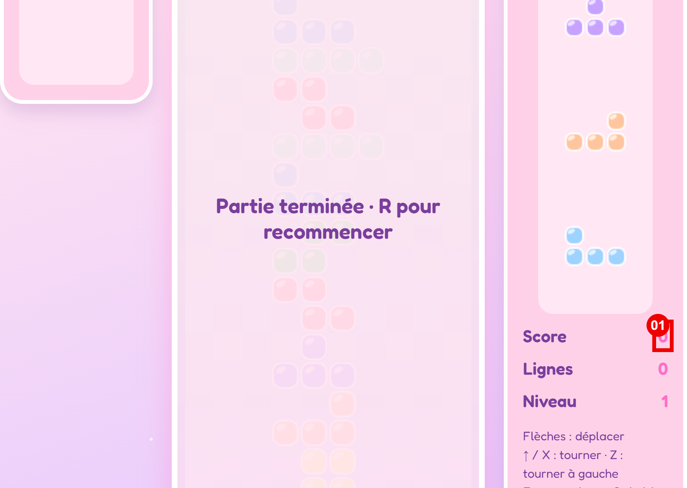
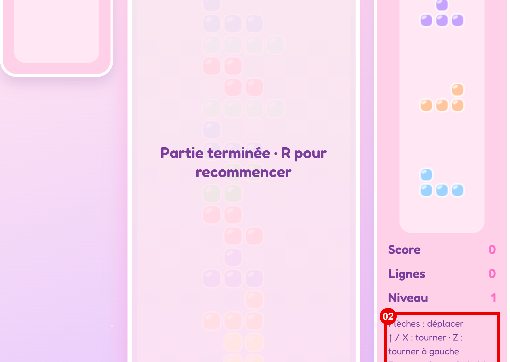
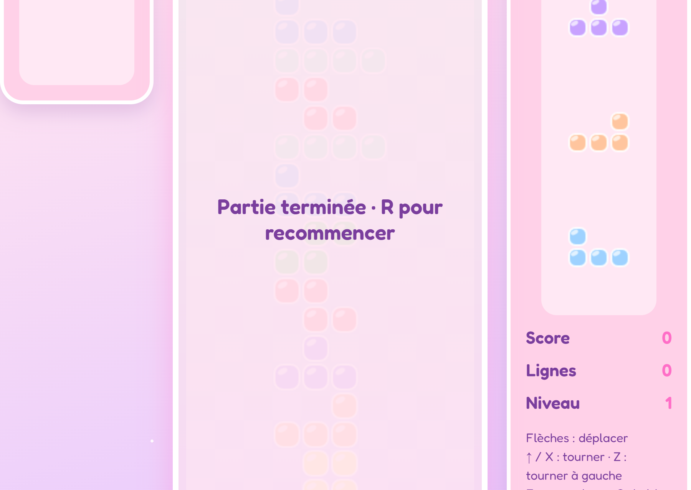

# Audit ergonomique — Tetris Bisounours

- **Cible** : https://jlg-formation.github.io/tetris-gia/ (écran de jeu unique, viewport testé 720 × 511)
- **Date** : 2026-10-23
- **Critères audités** : Guidage, Charge de travail, Contrôle explicite, Adaptabilité, Gestion des erreurs, Homogénéité / Cohérence, Signifiance des codes et dénomination, Compatibilité
- **Référentiel** : [ux-audit.github.io](https://ux-audit.github.io/) (Bastien & Scapin)

## Synthèse

| Sévérité | Nombre |
|---|---|
| Bloquant | 0 |
| Majeur | 4 |
| Mineur | 2 |

Le jeu est lisible dans son ensemble : la palette rose bonbon est cohérente et les panneaux sont clairement distingués. Les principaux problèmes sont techniques et visuels : le plateau et les panneaux débordent du cadre (la zone d'apparition des pièces et les titres « Hold » et « Suivant » sont invisibles), les scores sont peu contrastés, et la partie démarre sans écran d'accueil ni action de l'utilisateur. Le jeu n'est pilotable qu'au clavier. Priorités : corriger le cadrage du plateau, puis le contraste des scores et l'absence de contrôles tactiles.

## 1. Guidage

### Constat 01 — Scores peu contrastés sur fond rose · `majeur`

- **Sous-critère** : Lisibilité (contraste)
- **Où** : https://jlg-formation.github.io/tetris-gia/ · panneau de droite, valeurs Score, Lignes et Niveau



**Ce qui se passe** : les valeurs sont écrites en rose (`#ff6ec7`) sur un fond rose pâle (`#ffd1e8`). Le contraste mesuré est d'environ 1,9:1. À l'inverse, les libellés en violet (`#7a3e9d`) atteignent environ 5,2:1.

**Pourquoi c'est un problème** : le référentiel demande de respecter les niveaux de contraste WCAG ou RGAA. Un contraste aussi faible oblige l'utilisateur à plisser les yeux pour lire son score pendant la partie, ce qui ajoute une charge de perception au moment où il doit déjà suivre le plateau.

**Recommandation** : écrire les valeurs dans la couleur violette des libellés, ou foncer le rose pour atteindre au moins 4,5:1 sur ce fond.

**Exemple de correctif** (indicatif, le CSS source n'a pas été inspecté) :

```css
/* avant */
#score, #lines, #level { color: #ff6ec7; }
/* après */
#score, #lines, #level { color: #7a3e9d; }
```

### Constat 02 — Texte d'aide trop petit (13 px) · `mineur`

- **Sous-critère** : Lisibilité (taille de caractères)
- **Où** : https://jlg-formation.github.io/tetris-gia/ · paragraphe d'aide sous les statistiques



**Ce qui se passe** : les commandes sont écrites en 13 px, alors que les autres textes de l'écran font 18 à 22 px. Le bloc comporte six lignes de commandes et se coupe en bas de l'écran (voir constat 04).

**Pourquoi c'est un problème** : le référentiel déconseille une taille inférieure à 16 px. Un texte si petit se lit mal et se perd dans la zone de vision périphérique, alors que c'est justement l'endroit où l'utilisateur cherche les commandes.

**Recommandation** : passer le texte à 16 px minimum et raccourcir les lignes pour qu'elles tiennent dans l'écran.

**Exemple de correctif** (indicatif) :

```css
/* avant */
.help { font-size: 13px; }
/* après */
.help { font-size: 16px; }
```

## 2. Charge de travail

Aucun constat.

## 3. Contrôle explicite

### Constat 03 — Partie lancée et terminée sans action de l'utilisateur · `majeur`

- **Sous-critère** : Actions explicites
- **Où** : https://jlg-formation.github.io/tetris-gia/ · écran de jeu à l'ouverture de la page


**Ce qui se passe** : à l'ouverture, la partie démarre directement, sans écran d'accueil ni bouton « Commencer ». Pendant que la page restait ouverte sans aucune touche pressée, les pièces se sont empilées jusqu'à l'affichage de « Partie terminée · R pour recommencer ».

**Pourquoi c'est un problème** : le référentiel demande que l'application n'exécute que les actions demandées par l'utilisateur. Ici, la partie se lance seule et se termine sans intervention. L'utilisateur qui arrive sur la page n'a pas eu le temps de comprendre les commandes et découvre un écran de fin. C'est une « mauvaise surprise » au sens de Bastien & Scapin.

**Recommandation** : afficher un écran d'accueil avec la mention « Appuyez sur Entrée pour commencer », et mettre la partie en pause tant que l'utilisateur n'a pas lancé la première action.

**Exemple de correctif** (indicatif) :

```html
<!-- après : état initial en pause, la partie démarre à l'appui sur Entrée -->
<div id="overlay">Appuyez sur Entrée pour commencer</div>
```

## 4. Adaptabilité

### Constat 04 — Plateau et panneaux coupés en haut et en bas · `majeur`

- **Sous-critère** : Flexibilité
- **Où** : https://jlg-formation.github.io/tetris-gia/ · viewport 720 × 511. Le haut du plateau est à y = -72 px, les titres « Hold » et « Suivant » sont à y = -66 px, et le paragraphe d'aide descend jusqu'à y = 564 px.



**Ce qui se passe** : le contenu est centré verticalement et déborde au-dessus du haut de la fenêtre. Ces zones ne sont pas accessibles par défilement, car la page reste à `scrollY = 0`. Résultat : environ 2 à 3 premières lignes du plateau sont invisibles, là où apparaissent les nouvelles pièces, et les titres des panneaux ne s'affichent pas. En bas, les dernières lignes d'aide (dont « P : pause · R : recommencer ») sont coupées.

**Pourquoi c'est un problème** : le référentiel demande que l'interface s'adapte au contexte de l'utilisateur. Un écran de portable ou une fenêtre de navigateur réduite suffit à rendre le jeu injouable à l'aveugle : l'utilisateur ne voit pas d'où tombent les pièces et ne peut pas trouver les commandes de pause et de recommencer.

**Recommandation** : permettre le défilement quand le contenu dépasse, ou faire mettre à l'échelle le plateau selon la hauteur disponible.

**Exemple de correctif** (indicatif, le CSS source n'a pas été inspecté) :

```css
/* avant */
main.game { display: flex; align-items: center; }
/* après : le centrage ne coupe plus le contenu qui déborde en haut */
main.game { display: flex; align-items: safe center; }
```

## 5. Gestion des erreurs

Aucun constat. Le jeu ne propose pas de saisie susceptible de provoquer une erreur.

## 6. Homogénéité / Cohérence

Aucun constat. Les deux panneaux, les statistiques et les libellés suivent la même typographie et la même palette.

## 7. Signifiance des codes et dénomination

### Constat 05 — Vocabulaire anglais et symboles peu parlants · `mineur`

- **Sous-critère** : Vocabulaire compris par l'utilisateur
- **Où** : https://jlg-formation.github.io/tetris-gia/ · titre du panneau de gauche (« Hold ») et paragraphe d'aide


**Ce qui se passe** : l'interface est en français, sauf le titre « Hold ». Les commandes utilisent des termes peu clairs : « chute » pour faire tomber la pièce d'un coup, « X » et « Z » pour tourner, et « C : hold » sans explication.

**Pourquoi c'est un problème** : le référentiel recommande un vocabulaire compris par l'utilisateur plutôt que des termes techniques. Un joueur francophone doit deviner la signification de « Hold », et ne peut pas deviner ce que fait « chute » ou pourquoi « X » et « Z » sont deux touches de rotation différentes.

**Recommandation** : traduire les termes et expliquer les symboles.

**Exemple de correctif** :

```html
<!-- avant -->
<h2>Hold</h2>
<!-- après -->
<h2>Réserve</h2>
```

## 8. Compatibilité

### Constat 06 — Commandes uniquement au clavier, aucun contrôle à l'écran · `majeur`

- **Sous-critère** : Loi de Jakob (habitudes des utilisateurs)
- **Où** : https://jlg-formation.github.io/tetris-gia/ · écran de jeu complet (aucun bouton, zéro élément focusable)


**Ce qui se passe** : toutes les actions passent par le clavier. Il n'existe aucun bouton pour déplacer, tourner, mettre en pause ou recommencer. Sur un téléphone ou une tablette, le jeu est impossible à jouer.

**Pourquoi c'est un problème** : selon la loi de Jakob, les utilisateurs s'attendent à retrouver sur tous les écrans des contrôles tactiles et des boutons visibles, comme dans les autres jeux et applications qu'ils connaissent. Un utilisateur sans clavier ne peut pas jouer, et la pause ou le redémarrage ne sont pas accessibles aux utilisateurs qui ne connaissent pas les raccourcis.

**Recommandation** : ajouter des boutons à l'écran (gauche, droite, rotation, chute, pause, recommencer), visibles et accessibles au clavier et à la souris.

**Exemple de correctif** (indicatif) :

```html
<!-- après -->
<button type="button" id="btn-pause">Pause (P)</button>
<button type="button" id="btn-restart">Recommencer (R)</button>
```

## Pour aller plus loin

- [Critères Bastien & Scapin](https://ux-audit.github.io/criteres/) : vue d'ensemble des 8 critères.
- [Lisibilité](https://ux-audit.github.io/criteres/01d-lisibilite) : contraste et tailles de caractères (constats 01 et 02).
- [Actions explicites](https://ux-audit.github.io/criteres/03a-actions-explicites) : actions non demandées (constat 03).
- [Flexibilité](https://ux-audit.github.io/criteres/04a-flexibilite) : adaptation au contexte (constat 04).
